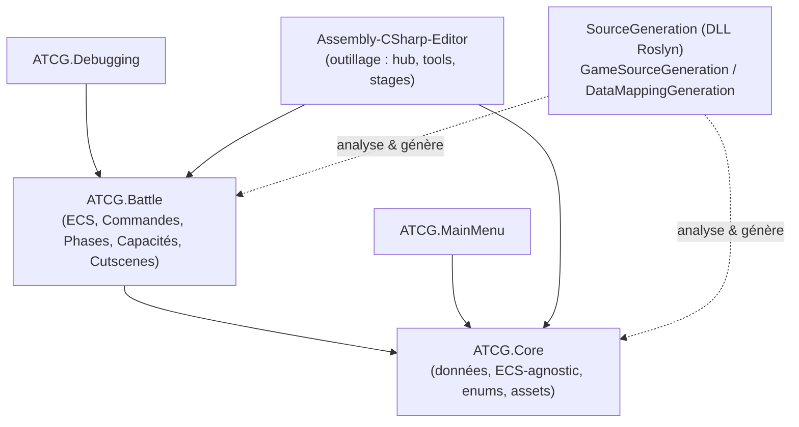
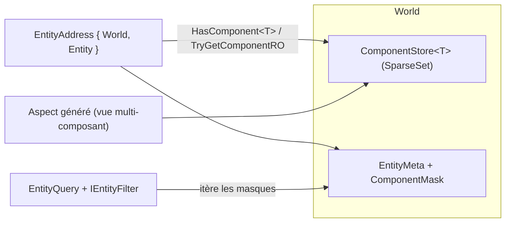
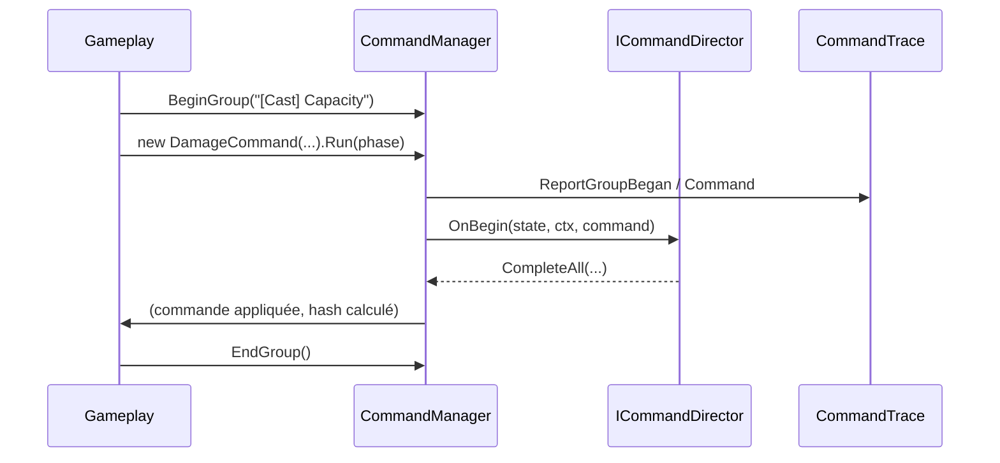
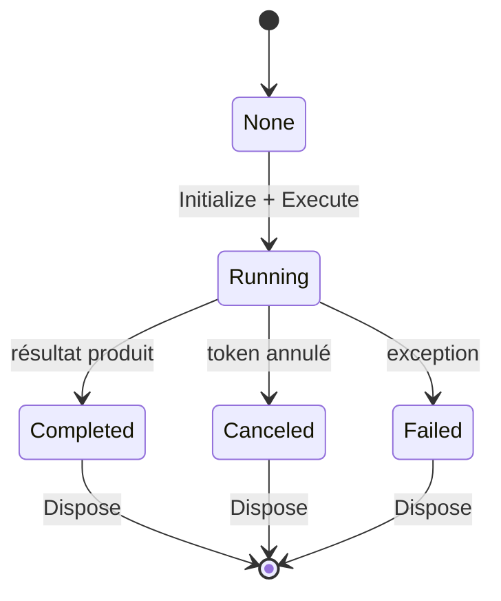
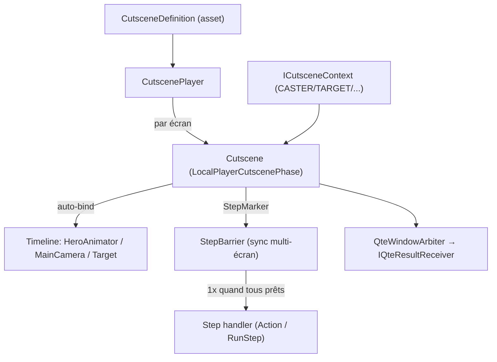

# Antros — Architecture technique

> **Antros / ATCG** — jeu de cartes tactique au tour par tour, multi‑écran, développé sous **Unity 6 (6000.5)** en **C#**, rendu **URP** stylisé (FlatKit), mise en scène **Timeline + Cinemachine**.
>
> Ce document décrit l'architecture logicielle du projet et met en lumière les systèmes conçus sur mesure : **ECS maison**, **bus de Commandes** sérialisable, **machine à Phases** asynchrone, **systèmes data‑driven** (Capacités, Cutscenes), **génération de code Roslyn** et **outillage éditeur** complet.

---

## Table des matières

1. [Principes directeurs](#1-principes-directeurs)
2. [Organisation en assemblies](#2-organisation-en-assemblies)
3. [Moteur ECS maison](#3-moteur-ecs-maison)
4. [Système de Commandes](#4-système-de-commandes)
5. [Machine à Phases asynchrone](#5-machine-à-phases-asynchrone)
6. [Système de Capacités (data‑driven)](#6-système-de-capacités-data-driven)
7. [Système de Cutscenes générique](#7-système-de-cutscenes-générique)
8. [Génération de code (Roslyn)](#8-génération-de-code-roslyn)
9. [Outillage éditeur](#9-outillage-éditeur)
10. [Grille hexagonale & pathfinding](#10-grille-hexagonale--pathfinding)
11. [Réseau, multi‑écran & présentation](#11-réseau-multi-écran--présentation)
12. [Synthèse des compétences démontrées](#12-synthèse-des-compétences-démontrées)

---

## 1. Principes directeurs

L'architecture repose sur quelques décisions structurantes, appliquées de façon transverse :

- **Séparation stricte données / présentation.** La simulation (état de jeu) vit dans un **ECS déterministe** ; l'affichage vit dans une couche **Runtime** de `MonoBehaviour` instanciés **par écran**. Aucun système de gameplay ne dépend du rendu.
- **Réseau‑agnostique par conception.** Les mutations d'état passent par des **Commandes sérialisables** portant un identifiant stable et un hash de résultat déterministe : la même commande produit le même effet des deux côtés, ce qui rend la réplication et le rejouage naturels.
- **Data‑driven autant que possible.** Capacités, cutscenes, cartes, statuts sont décrits par des **assets** et des **attributs**, pas par du code impératif dispersé. Le comportement spécifique est isolé dans des points d'extension étroits.
- **Génération de code pour supprimer le boilerplate.** Des **générateurs Roslyn incrémentaux** produisent aspects ECS, mapping de conteneurs, steps de capacités, signatures de statuts… avec diagnostics de compilation dédiés.
- **Outillage first‑class.** Un hub éditeur unifié (100 % **UI Toolkit**, styles en **USS externe**) fournit navigateurs de données, timelines, stages d'authoring isolés et éditeurs qui **réécrivent le code source** de façon sûre.
- **Asynchronicité maîtrisée.** Le flux de jeu est modélisé par une **machine à Phases** `Awaitable` avec cycle de vie, annulation propagée et résultats typés.

---

## 2. Organisation en assemblies

Le code est découpé en assemblies Unity (`.asmdef`) pour imposer un sens de dépendance clair et des temps de compilation courts.



| Assembly | Rôle |
|---|---|
| **ATCG.Core** | Données pures et contrats partagés : assets de cartes/capacités/cutscenes, enums, grille hexagonale, bases de données. Aucune dépendance au runtime de bataille. |
| **ATCG.Battle** | Le cœur runtime : **ECS**, **Commandes**, **Phases**, systèmes **Capacités / Cutscenes / Passifs / Statuts**, joueurs et tours. |
| **ATCG.MainMenu / ATCG.Debugging** | Menu et outils de debug in‑game. |
| **Assembly‑CSharp‑Editor** | L'outillage éditeur (hub `AntrosEditorWindow` + tools). |
| **SourceGeneration** | Générateurs Roslyn compilés en DLL et branchés comme analyzers. |

> **Compétence** : maîtrise du découpage en assemblies (couplage dirigé, isolation compile‑time, séparation données/logique/éditeur).

### 2.1 Le socle `ATCG.Core` en détail

`ATCG.Core` est l'assembly **fondation** : le modèle de données, les contrats partagés et les briques réutilisables dont **tout le reste dépend** (Battle, MainMenu, éditeur). Il ne connaît rien du runtime de bataille — la dépendance est strictement unidirectionnelle.

| Module (`Core/…`) | Contenu & rôle |
|---|---|
| **Databases** | `GameDatabaseObject` — base de tous les assets de jeu : un `ScriptableObject` doté d'un **GUID stable** auto‑généré (`OnValidate`/`Reset`) qui sert d'identité inter‑sessions et réseau. `GameDatabase` en est le registre. |
| **Cards** | `GameCardData`, `HeroCardData`, `CardRarity`, `IGameCard`, `DebugStartingDeck` — le modèle de cartes. |
| **Capacities** | Contrats et données de capacités (`IAbility`, `CapacityTags`, `CapacityData` + attributs `[WithStep]` / property‑keys / target‑tags) — la partie *déclarative* du système de capacités. |
| **Cutscenes** | `CutsceneDefinition` (base), `AttackCutscene`, `DeployCutscene`, `ICutsceneCasterAnimatorSource` — les définitions data‑driven de cinématiques, communes au runtime et à l'éditeur. |
| **Elements** | `Element`, `ElementData`, `ElementExtensions` — le système élémentaire (affinités, données par élément). |
| **HexGrids** | `HexCoordinate`, `HexCell`, `HexDirection` — les mathématiques de grille hexagonale, indépendantes du gameplay. |
| **GameModes / Scenes / Multiplayer** | Orchestration haut niveau : `GameModeController`, phases de base (matchmaking, join, attente des joueurs, chargement de scène), `MultiplayerManager` (intégration réseau/CloudCode). |
| **Metrics** | `GameMetrics` (constantes d'équilibrage tunables), `GameAssets`, `GameScenes` — configuration centralisée. |
| **UI** | Composants UI Toolkit runtime réutilisables (`BarUI`, `CustomButtonUI`, `MultiChoiceUI`, `RowUI`). |
| **Utilities** | Helpers transverses (`AwaitablesUtilities`, `GameMaths`, `InputSystemUtilities`, `TweenUtilities`). |

> À noter : l'ECS de bataille vit dans `ATCG.Battle/Entities/Core` (voir §3) — un dossier « Core » interne, distinct de l'assembly `ATCG.Core`. La donnée « froide » (assets, enums, math) est dans `ATCG.Core` ; l'état « chaud » de simulation (entités, composants runtime) est dans `ATCG.Battle`.
>
> **Compétence** : conception d'un socle de données stable et réutilisable (identité par GUID, assets data‑driven, séparation donnée froide / état runtime, configuration centralisée).

---

## 3. Moteur ECS maison

Plutôt que de dépendre d'un framework tiers, le projet embarque un **Entity‑Component‑System écrit sur mesure**, orienté performance et déterminisme.

### 3.1 Briques

| Élément | Description |
|---|---|
| `World` | Conteneur d'entités et de composants (partitionné en `World.cs`, `World.Components.cs`, `World.Queries.cs`, `World.registry.cs`). |
| `Entity` / `EntityMeta` | Handle léger (id) + métadonnées d'archétype. |
| `EntityAddress` | `readonly struct` (`{ World, Entity }`) **compatible Burst** — la référence stable d'une entité, passée partout par valeur. |
| `IEntityComponent` (struct) | Donnée pure. Stockée sans allocation. |
| `SparseSet` / `ComponentStore` | **Stockage en sparse‑set** : itération dense, ajout/retrait/accès O(1), cache‑friendly. |
| `ComponentMask` / `ComponentMaskBuilder` | **Masques de bits d'archétype** pour tester la présence de composants sans allocation. |
| `ComponentRegistry` / `ComponentID` / `ComponentRef` | Attribution d'ID de composant et accès typé. |
| `IEntityAspect` + `EntityAspectManager` | **Aspects** : vues typées regroupant plusieurs composants d'une même entité (ex. `BattleCellAspect`, `CapacityCasterAspect`, `ConstructionAspect`), **générées par code**. |
| `EntityQuery` / `EntityQueryBuilder` / `IEntityFilter` | Système de **requêtes filtrées** sur le monde (ex. filtrer les ennemis d'un joueur). |
| `CommandListenerComponent` (CLC) | Pont ECS ↔ Commandes : une entité peut **écouter des commandes** via un composant, sans coupler la logique au bus. |

### 3.2 Points forts d'ingénierie

- **Sparse‑set + masques d'archétype** : structures de données classiques d'ECS haute performance, implémentées à la main.
- **`EntityAddress` en `readonly struct` Burst‑compatible** : zéro allocation, sûr à copier, adressage stable même après réorganisation du stockage.
- **Aspects générés** : l'accès multi‑composant est validé et typé à la compilation, sans écrire le code répétitif.
- **Requêtes découplées** via filtres (`IEntityFilter`) réutilisables (ex. ciblage de capacité, sélection d'entité).



> **Compétences** : structures de données bas niveau (sparse set, bitmask), conception d'un ECS complet, sensibilité performance (Burst, sans‑alloc), généricité et sûreté de type.

---

## 4. Système de Commandes

Toute mutation d'état de jeu passe par une **Commande**. C'est le socle qui rend le jeu déterministe, traçable, réseau‑ready et débogable.

### 4.1 Modèle

```csharp
public abstract partial class Command<TInfos> : IDisposable, ICommand
    where TInfos : struct, ICommandInfos
{
    public BattleID ID { get; }          // identité stable et sérialisable
    public string Source { get; }        // origine (traçabilité)
    protected TInfos infos;              // payload = struct sérialisable
    public int ResultHash => infos.GetHashCode(); // empreinte déterministe

    protected abstract void Process(in CommandContext context);
    public void Inject<TCommand>(in CommandContext context) where TCommand : ICommand, new();
}
```

- **Payload typé** (`TInfos : struct, ICommandInfos`) : chaque commande transporte une donnée valeur sérialisable.
- **Identité + traçabilité** : `BattleID` unique, `Source`, et une **hiérarchie parent/embeds** (une commande peut en injecter d'autres → arbre de commandes).
- **`ResultHash` déterministe** : empreinte du résultat, exploitable pour la validation croisée client/serveur et la détection de désync.
- **Cycle de vie** `Init → Process → Dispose` encadré, avec pooling (`ListPool`) pour éviter les allocations.

### 4.2 Orchestration : `CommandManager`

- **Exécution** via extensions fluides : `command.Run(phase)`, `RunAsync`, `Schedule(...)`.
- **Groupes imbriqués** : `BeginGroup("[Cast] IceSpear") … EndGroup()` empilent un contexte ; les commandes injectées héritent du groupe courant (auto‑groupe si aucun n'est ouvert).
- **Directors** : `ICommandDirector<T>` réagissent aux commandes (`OnBegin`, `Play`) — c'est ainsi qu'un QTE ou une entité s'abonne à un type de commande sans couplage direct.
- **Tracing** : `CommandTrace` enregistre groupes et commandes → alimente directement l'outil éditeur **Command Timeline** (visualisation du flux de commandes).



> **Compétences** : pattern Command à l'échelle d'un jeu, conception réseau/déterministe (sérialisation + hashing), arbre de commandes, observateurs découplés, instrumentation/tracing pour le debug.

---

## 5. Machine à Phases asynchrone

Le déroulé du jeu (sélection d'une cible, création d'un chemin, lancement d'une capacité, cutscene…) est modélisé par des **Phases** : des unités de travail asynchrones, annulables et composables.

```csharp
public abstract class Phase<TResult> : IPhase
{
    public PhaseStatus CurrentStatus { get; }     // None/Running/Completed/Canceled/Failed
    protected abstract Awaitable<TResult> Execute(CancellationToken token);
    // + Initialize / Dispose, événements OnInitialized/OnCompleted/OnDisposed
}
```

- **Cycle de vie explicite** `Initialize → Execute → Dispose`, chaque étape `Awaitable`.
- **Résultat typé** : `await new SelectEntityPhase<EnemyFilter>(...)` renvoie directement les entités sélectionnées (`PhaseResult<T>` : Success / Cancel / Failure).
- **Annulation propagée** : gestion soignée de `OperationCanceledException` (Unity ne rethrow pas toujours à travers `await` — le code force `ThrowIfCancellationRequested`).
- **Phases joueur** : `LocalPlayerPhase<T>` porte le `LocalBattlePlayer` concerné.
- **Listeners & HUD** : un système d'écouteurs (`IPhaseListener<T>`) permet à l'UI de réagir. Les **HUD Phases** (`IGlobalHUDPhase` / `ILocalHUDPhase`) masquent automatiquement le HUD pendant une phase (sélection, cutscene…) via des **propriétés à priorités** (`Priority<bool>` de la lib Channeled Properties), avec fondu.



> **Compétences** : modélisation d'un flux de jeu par machine à états asynchrone, `async/await` avec annulation robuste, composition de phases, réactivité UI découplée par priorités.

---

## 6. Système de Capacités (data‑driven)

Une capacité (sort, compétence) est un **asset** `CapacityData` décrivant *quoi* faire ; le *comment* est réparti dans des points d'extension étroits, et une bonne partie est **générée**.

### 6.1 Anatomie d'une capacité

- **`CapacityData`** (asset) : coût, élément, description, **patterns de ciblage** (`CastPatterns`), **setups** de pré‑cast, **propriétés déclarées** ajustables, et le **director de cutscene**.
- **Steps déclaratifs** : la capacité annote sa classe avec `[WithStep("Hit")]`. Un générateur produit les constantes de step, le tableau `DeclaredSteps` et la table `MapSteps` — la logique de chaque step vit dans une méthode `Execute{Step}` partielle.
- **Ciblage** : un `HexPatternBuilder` (pattern spirale, filtres…) résout des cellules, puis `GetTargets` enregistre des cibles **taggées** dans un `CapacityTargets` (tags `CELL`, `MEMBER`, + tags custom). Les steps requêtent ensuite `ctx.Targets.WithTags(...)` (sémantique ET).
- **Propriétés** : `CapacityPropertyBag` fournit un **schéma fermé** typé (seules les propriétés déclarées sont écrivables), rempli par les steps au fil du temps.

### 6.2 Exécution : `CastCapacityPhase`

`CastCapacityPhase` orchestre le cast de bout en bout :

1. Collecte un **director par écran** et prépare une **barrière de steps** (`StepBarrier`).
2. Exécute les **setups** (pré‑conditions/coûts).
3. Joue les cutscenes en parallèle ; chaque **marqueur de step** franchi sur la timeline est reporté à la barrière.
4. Quand **tous les écrans** ont franchi un step, il est exécuté **une seule fois** avec l'effectivité issue des **QTE**.

Le code a été refactorisé pour extraire la construction pattern/cibles (`BuildHitPattern`, `ResolveTargets`, réutilisées à chaque step) et découper l'exécution (`RunSetups`, `MapSteps`, `PlayAllDirectors`).

> **Compétences** : conception data‑driven, séparation données/logique, système de ciblage flexible par tags, synchronisation multi‑écran (barrière), schéma de propriétés typé et fermé.

---

## 7. Système de Cutscenes générique

Initialement lié aux capacités, le système de cinématiques a été **généralisé** pour servir *tout* évènement (capacités, **attaques physiques**, **déploiements de cartes**, arrivées…), avec un moteur de lecture et un authoring communs.

### 7.1 Modèle unifié

- **`CutsceneDefinition`** (base) : porte le **director** (prefab + `PlayableDirector` + `TimelineAsset`) et les **steps déclarés**. Les sous‑types (`AttackCutscene`, `DeployCutscene`, `CapacityData`) déclarent leurs steps via `[WithStep]`.
- **`Cutscene`** (runtime générique) : joue une timeline pour **un écran**, connecte les éléments à un **contexte**, arbitre les QTE, positionne la scène sur le caster et **bind automatiquement** les pistes.
- **`CapacityCutscene`** : simple dérivé de `Cutscene` (events QTE typés + restauration du caster) — la duplication a été supprimée.
- **`CutscenePlayer` / `BattleCutscenes`** : jouent une définition sur **tous les écrans**, avec une **barrière de steps** garantissant qu'un handler de step ne s'exécute qu'une fois tous les écrans synchronisés. Chaque écran joue dans une `LocalPlayerCutscenePhase` (donc le HUD se cache automatiquement).

### 7.2 Contexte & binding automatique

- **`ICutsceneContext`** : sac de propriétés typé et clé‑valeur (`CASTER`, `TARGET`, `SCREEN_PLAYER`, `CAST_POINT`, `COORDINATE_SOLVER`, `QTE_RECEIVER`…). Les éléments de cutscene lisent le contexte au lieu de dépendre d'un système concret → **mêmes éléments, même aperçu éditeur** pour tous les types.
- **Canaux auto‑bindables** (`CutsceneChannels`) : une piste nommée `HeroAnimator` se bind à l'Animator du caster, `MainCamera` au brain Cinemachine de l'écran, `Target` (optionnelle) à l'Animator de la cible. Le vocabulaire des canaux est générique ; la résolution est côté consommateur.

### 7.3 QTE réseau‑agnostiques

Le sous‑système QTE (`QteWindowArbiter`, `IQteResultReceiver`, `QteResultAccumulator`) arbitre les fenêtres de QTE (FIFO), lit l'input local et **signale** un score ; c'est le *receiver* (rôle owner) qui décide d'émettre une `QteCommand` répliquée. La présentation reste identique des deux côtés.



> **Compétences** : généralisation d'un système (refactor de fond, héritage propre), Timeline/Playables avancé (binding générique, notifications/markers), synchronisation multi‑écran, découplage présentation/réseau.

---

## 8. Génération de code (Roslyn)

Le projet embarque ses propres **générateurs de source incrémentaux** (compilés en DLL, branchés comme analyzers) pour éliminer le boilerplate et garantir la cohérence code ↔ données.

| Générateur | Produit |
|---|---|
| **Aspects ECS** (`EntityAspectGenerator`, `EntityAspectInterfaceGenerator`) | Les vues multi‑composant typées à partir de déclarations. |
| **Steps de capacités** (`CapacityDataGenerator`) | À partir de `[WithStep]` : constantes, `override DeclaredSteps`, et (côté capacité uniquement) champs `StepData` sérialisés + `MapSteps`. |
| **Run de capacités** (`CapacityRunGenerator`) | Le squelette d'exécution/steps. |
| **Signatures de statuts** (`StatusSignatureGenerator`) | Le câblage des statuts. |
| **Composants itérables** (`IteratableComponentGenerator`) | Boucles/itérations générées. |
| **Data‑mapping** (`DataMappingGeneration`) | Les **conteneurs** reliant assets et implémentations. |

Points remarquables :

- **Générateurs incrémentaux** (`IIncrementalGenerator`, `ForAttributeWithMetadataName`) → performants et bien intégrés au pipeline Unity.
- **Diagnostics dédiés** (ex. `HTX010‑012` : nom de step vide, collision d'identifiants, doublon) → erreurs de compilation claires côté auteur.
- **Détection d'héritage** pour n'émettre la partie data‑driven que pour les capacités, tout en généralisant les steps déclaratifs à tous les types de cutscenes.

> **Compétences** : métaprogrammation Roslyn, conception d'API par attributs, diagnostics de compilation, intégration d'analyzers dans Unity.

---

## 9. Outillage éditeur

L'éditeur est traité comme un produit à part entière : un **hub unifié**, 100 % **UI Toolkit**, **styles en USS externe** (aucun style inline, aucune IMGUI).

### 9.1 Hub & découverte automatique

- **`AntrosEditorWindow`** : une fenêtre unique avec un rail latéral. Tout `IEditorTool` (constructeur public sans paramètre) est **découvert par réflexion** et ajouté au rail — **aucun code du hub à toucher** pour ajouter un outil.
- Cycle de vie `BuildUI / OnActivated / OnDeactivated` : les outils inactifs ne consomment rien (pas d'abonnements ni de timers en arrière‑plan).

### 9.2 Outils notables

| Outil | Rôle |
|---|---|
| **Cutscenes** | Explorer / Éditer / Settings ; authoring des timelines, réparation d'assets (director variant + timeline), gestion générique des steps. |
| **Capacities** | Navigateur d'assets + édition dans le stage partagé. |
| **Characters** | Intégration du pack **Synty Sidekick** : preview 3D intégrée (`PreviewRenderUtility`, post‑process global, orbite/pan/zoom, recentrage), export **avec swap automatique du shader vers FlatKit**, création d'un nouveau perso (duplication d'un template), liste maître‑détail. |
| **Command Timeline** | Visualisation du flux de commandes (alimenté par `CommandTrace`). |
| **World Inspector / Database Browser / Card Manager / Cheats** | Inspection du monde ECS, navigation des bases de données, gestion des cartes, triche de debug. |

### 9.3 Stages d'authoring isolés

- **`CutsceneStage`** (dérive de `PreviewSceneStage`) : ouvre une **scène en mémoire** (pas de `.unity`), y instancie un environnement de test (héros, caméra, `DebugCutsceneRig`) + le director de la cutscene, verrouille la fenêtre Timeline dessus et rebind les pistes auto‑bindables **par nom de canal** contre le rig présent — le tout survivant aux domain reloads.
- **`CutsceneAutoBinder`** : rebind générique + **activation conditionnelle** d'un stand‑in optionnel (ex. la cible n'apparaît que si la piste `Target` est présente).

### 9.4 Édition qui réécrit le code source

L'éditeur de steps (`EditStepsModal` + `CapacityStepEditor`) **modifie le code source en toute sûreté** : ajout/renommage/suppression des attributs `[WithStep]`, génération de stubs `Execute{Step}`, et **mise à jour des marqueurs Timeline** correspondants — puis recompilation. C'est un pont éditeur → code → génération non trivial.

> **Compétences** : UI Toolkit avancé (MultiColumnListView, TwoPaneSplitView, previews 3D, drag/clavier), architecture d'outillage extensible, `PreviewSceneStage` / Timeline / Cinemachine côté éditeur, manipulation d'AssetDatabase et **réécriture de source contrôlée**.

---

## 10. Grille hexagonale & pathfinding

- **`HexCoordinates`** et l'espace `HexGrids` : coordonnées hexagonales, conversions monde ↔ grille.
- **Patterns** composables (`HexPatternBuilder`, `SpiralPattern`, contrôleurs de pattern comme `BattleIgnoreOriginPatternController`) : brique commune au ciblage des capacités et à la portée des attaques.
- **`HexPathfinder`** : recherche de chemin sur la grille (déplacements, portée).

> **Compétences** : géométrie hexagonale, algorithmes de pathfinding, conception d'API composable (builder de patterns).

---

## 11. Réseau, multi‑écran & présentation

- **Autorité ECS + présentation par écran.** La vérité est dans l'ECS ; chaque `RuntimeLocalBattlePlayer` possède sa propre instance runtime des entités (héros, déployables, VFX…). Les cutscenes et QTE jouent **sur chaque écran** avec un contexte par écran.
- **Commandes répliquées & rôles owner.** Les mutations passent par des commandes ; seul le joueur *owner* transforme un input local (ex. score de QTE) en commande réseau. Intégration **Unity CloudCode** pour le back‑end.
- **Rendu.** URP + **FlatKit** (rendu stylisé cel‑shading) ; **Cinemachine** avec **canaux de sortie par écran** (une cutscene ne « fuit » pas sur l'écran de l'autre joueur) ; **Timeline** pour la mise en scène.

> **Compétences** : architecture multijoueur/hotseat, séparation autorité/présentation, pipeline de rendu URP, mise en scène Timeline/Cinemachine.

---

## 12. Synthèse des compétences démontrées

| Domaine | Preuve dans le projet |
|---|---|
| **Architecture logicielle** | Découpage en assemblies, séparation données/présentation, systèmes découplés par contrats et évènements. |
| **Structures de données & perf** | ECS maison (sparse‑set, masques d'archétype), `readonly struct` Burst‑compatibles, pooling, sans‑allocation. |
| **Design patterns** | Command (bus sérialisable + directors), State/Machine à Phases, Observer (listeners), Builder (patterns hex), Strategy (filtres/containers). |
| **Programmation asynchrone** | Phases `Awaitable` avec annulation propagée, orchestration parallèle multi‑écran, barrières de synchronisation. |
| **Métaprogrammation** | Générateurs Roslyn incrémentaux avec diagnostics, API par attributs. |
| **Data‑driven design** | Capacités / cutscenes / cartes / statuts pilotés par assets + attributs, points d'extension étroits. |
| **Outillage & DX** | Hub éditeur extensible (UI Toolkit/USS), stages d'authoring, timelines, previews 3D, édition réécrivant le source. |
| **Réseau & déterminisme** | Commandes à hash déterministe, réplication, rôles owner, CloudCode. |
| **Rendu & mise en scène** | URP/FlatKit, Cinemachine multi‑écran, Timeline/Playables (binding générique, markers). |
| **Gameplay tactique** | Grille hexagonale, pathfinding, ciblage par patterns et tags, QTE, cutscenes intégrées au flux de commandes. |

---

*Document d'architecture — projet Antros / ATCG.*
